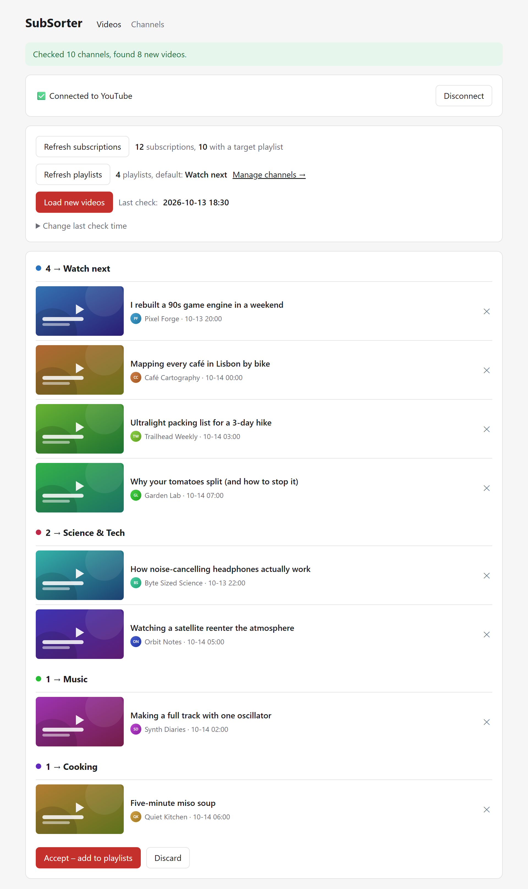
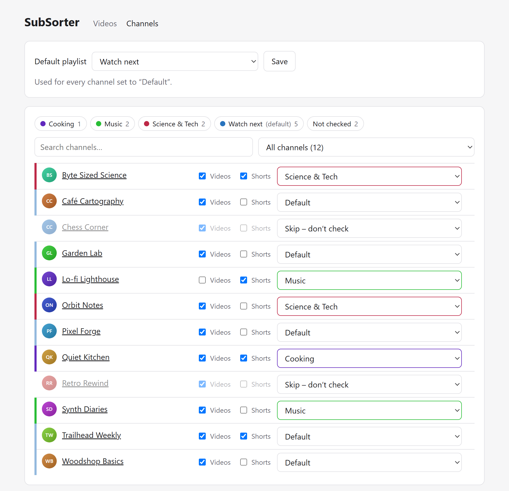
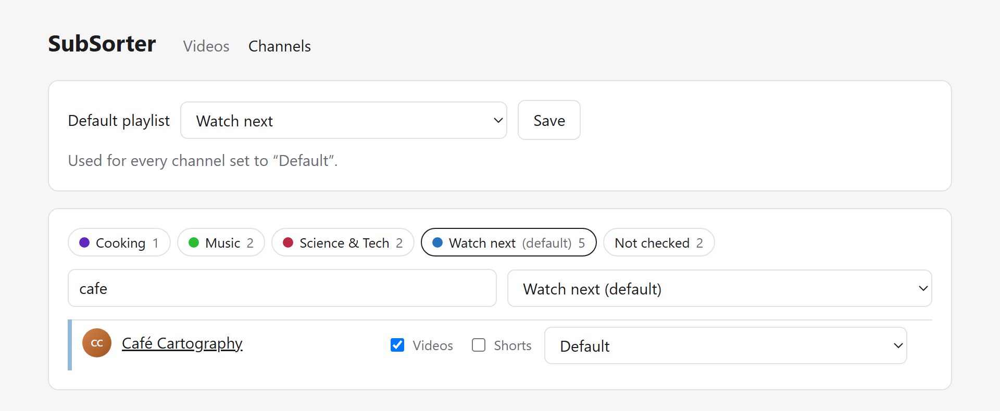

# SubSorter

[](https://github.com/FeaXR/SubSorter/actions/workflows/ci.yml)
[](https://github.com/FeaXR/SubSorter/releases/latest)
[](https://github.com/FeaXR/SubSorter/pkgs/container/subsorter)
[](LICENSE)

**Sort new uploads from your YouTube subscriptions into your own playlists.**

SubSorter is a small self-hosted web app. It collects new uploads from the channels you're
subscribed to and adds them to playlists on your channel, with a target playlist of your
choice for each channel.

Think of it as a subscription feed you can turn into playlists: check for new uploads,
review the list, and accept them into the right playlists in one click. Or let it run on a
schedule without review.

<picture>
  <source media="(prefers-color-scheme: dark)" srcset="docs/screenshots/dashboard-dark.png">
  
</picture>

## Screenshots

**Channels:** choose a target playlist and Videos / Shorts per channel. Rows are
color-coded by playlist, and the legend shows how many channels feed each one.

<picture>
  <source media="(prefers-color-scheme: dark)" srcset="docs/screenshots/channels-dark.png">
  
</picture>

**Filter and search:** click a playlist in the legend to see every channel that feeds it.
Search ignores accents, so `cafe` finds *Café Cartography*.

<picture>
  <source media="(prefers-color-scheme: dark)" srcset="docs/screenshots/channels-filtered-dark.png">
  
</picture>

<sub>Screenshots use fictional channels and videos with placeholder thumbnails.</sub>

## Features

- **Per-channel target playlist:** send each subscription to any playlist on your channel,
  use a default playlist for the rest, or skip a channel entirely.
- **Videos and/or Shorts per channel:** pick regular videos, Shorts, both, or neither.
- **Review before adding:** new uploads show up grouped by target playlist with
  thumbnails. Remove anything you don't want, then accept.
- **No duplicates:** only uploads published since the last accepted check are picked up.
  You can set that time manually, e.g. when migrating from another tool.
- **Quota friendly:** one API request per checked channel, with no extra calls for thumbnails
  or channel icons. Skipped channels aren't requested at all.
- **Optional automatic mode:** a scheduler container can run the whole flow on a cron schedule.
- **Channel management UI:** search ignores accents and case, filter by playlist or content type,
  and channels are color-coded by target playlist.
- **Single container + SQLite**, no external database or build step.

## How it works

1. **Refresh subscriptions / Refresh playlists** pulls your subscriptions and your own
   playlists from the YouTube Data API.
2. **Load new videos** reads each channel's auto-generated uploads playlist. A channel
   ID `UC…` maps to `UULF…` (long-form videos), `UUSH…` (Shorts) or `UU…` (all uploads).
   Only items published after the last check time are collected.
3. **Accept** inserts the collected videos into their target playlists, oldest first, then
   moves the last check time forward to the newest collected video.

Videos that fail to be added stay in the list with the error and can be retried. A quota
error stops the run cleanly.

## Requirements

- Docker (or PHP 8.3+ with Composer for development)
- A Google Cloud project with the **YouTube Data API v3** enabled
- An HTTPS URL for the app, e.g. through a reverse proxy or a Cloudflare Tunnel.
  Google only allows plain `http` OAuth redirects for `localhost`.

## Setup

### 1. Google OAuth client

1. In the [Google Cloud console](https://console.cloud.google.com/), enable **YouTube Data API v3**.
2. Configure the **OAuth consent screen**. Either publish the app (it can stay unverified for
   personal use) or add your account as a test user. In *Testing* mode Google expires
   refresh tokens after 7 days, so you'd need to log in again weekly.
3. Create credentials of type **OAuth client ID → Web application**, with the authorized
   redirect URI `https://<your-domain>/auth/google/callback`.

### 2. Configure

```bash
cp .env.example .env
```

| Variable | Description |
|---|---|
| `APP_URL` | Public URL of the app, e.g. `https://yt.example.com` |
| `GOOGLE_CLIENT_ID`, `GOOGLE_CLIENT_SECRET` | From the OAuth client |
| `GOOGLE_REDIRECT_URI` | Defaults to `${APP_URL}/auth/google/callback` |
| `DISPLAY_TIMEZONE` | Timezone for showing and entering times, e.g. `Europe/London` (default `UTC`) |
| `INCLUDE_SHORTS` | Shorts setting for newly found channels (default `false`) |
| `AUTO_SYNC_CRON` | Cron expression for automatic, unreviewed syncing (empty = manual only) |
| `BASIC_AUTH_USER`, `BASIC_AUTH_PASSWORD` | Optional HTTP basic auth for the whole UI |
| `YOUTUBE_CONCURRENCY` | Channels requested in parallel (default `20`) |

`APP_KEY` can be left empty when running in Docker: the container generates one on first
start and keeps it in the data volume. The stored Google token is encrypted with it.

### 3. Run

**Prebuilt image:** every push to `main` publishes `latest`, and every release publishes
its version number:

```bash
docker pull ghcr.io/feaxr/subsorter:latest   # newest build of main
docker pull ghcr.io/feaxr/subsorter:1.0.1    # a specific release
```

[`deploy/truenas.yaml`](deploy/truenas.yaml) is a complete Compose file using this image. It
works on TrueNAS SCALE ("Install via YAML") as well as any other Docker host. Pin a version
tag instead of `latest` if you prefer to update deliberately.

**Or build it yourself** from a clone:

```bash
docker compose up -d --build
# optional automatic sync:
docker compose --profile scheduler up -d
```

All state lives in the `/data` volume: the SQLite database and the generated app key.

### 4. First run

1. Open the app and **Log in with Google**.
2. Optionally set **Change last check time** to when you last collected videos. Otherwise
   tracking starts from the first **Load new videos**.
3. **Refresh subscriptions** and **Refresh playlists**.
4. On **Channels**, choose a default playlist and set targets / content per channel.
5. **Load new videos**, review, **Accept**.

## Command line

```bash
php artisan youtube:refresh-subs        # reload subscriptions
php artisan youtube:refresh-playlists   # reload your playlists
php artisan youtube:sync                # collect new videos into the review list
php artisan youtube:sync --refresh-subs --add   # full unattended run (what the scheduler does)
```

In Docker, prefix the command with `docker compose exec app`.

## API quota

The YouTube Data API allows 10,000 units per day by default. Checking a channel costs
1 unit and adding a video costs 50, so roughly 190 videos can be added per day. Remaining
videos stay in the list for the next day.

## Security notes

- Anyone who can open the UI can modify your playlists. Protect it with `BASIC_AUTH_*`,
  an access proxy (e.g. Cloudflare Access) or by keeping it on a private network.
- The app trusts `X-Forwarded-*` headers from any proxy so it works behind tunnels and
  reverse proxies. Don't expose the container port directly to the internet.
- OAuth tokens are stored encrypted in the database. `Disconnect` revokes the token at Google.

## Development

```bash
composer setup      # install, create .env + SQLite database, migrate
composer dev        # http://localhost:8080
composer test
composer lint       # Laravel Pint
```

The app is plain Laravel with Blade views. There's no frontend build step: CSS and JS are
inline in [`resources/views`](resources/views). The YouTube logic lives in
[`app/Services`](app/Services): `YouTubeClient` wraps the API and OAuth, and `PlaylistSync`
contains the use case.

## License

[MIT](LICENSE)

This project is not affiliated with or endorsed by YouTube or Google.
